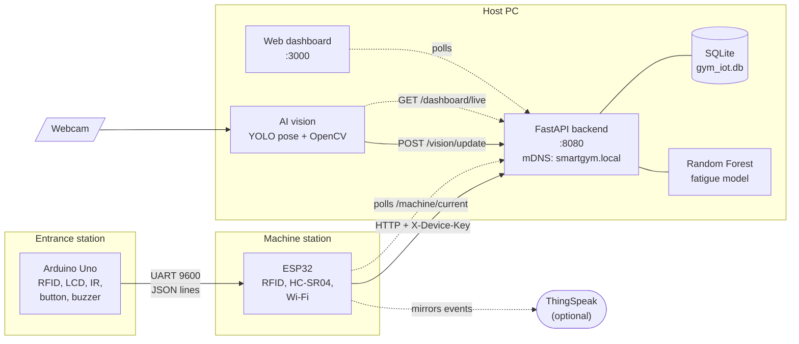
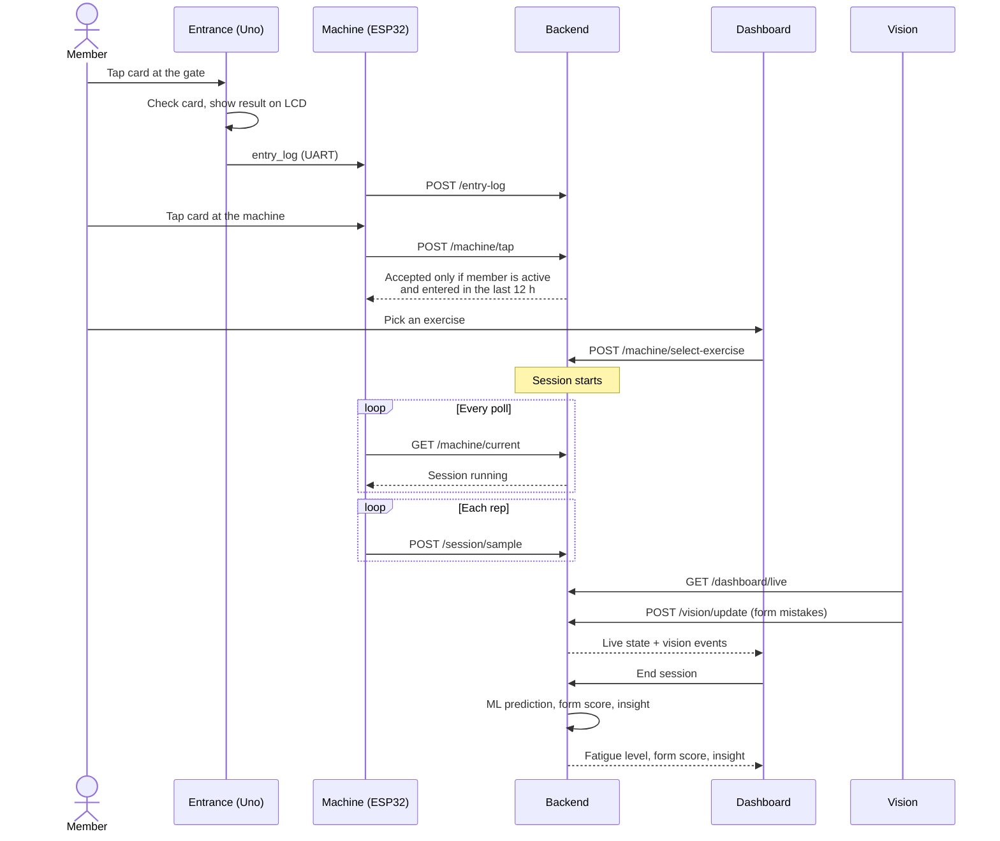
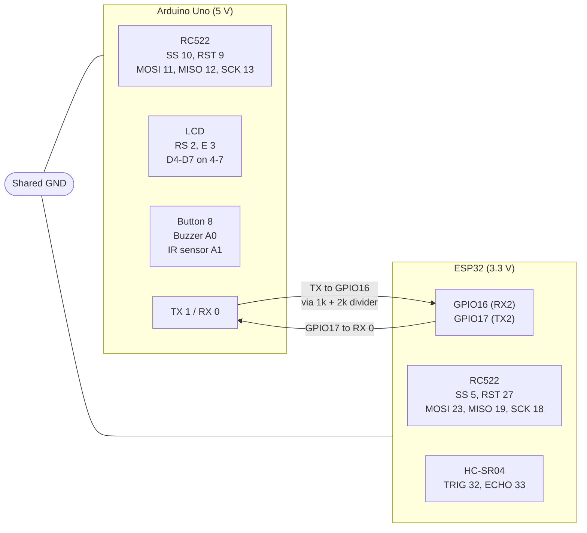
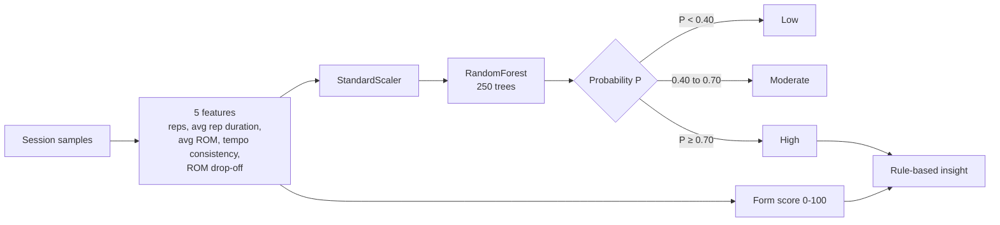

# Smart Gym IoT System

A gym monitoring system built from two microcontrollers, a FastAPI backend, a camera-based form checker and a browser dashboard.

| Part | What it does |
|---|---|
| Entrance station (Arduino Uno) | Reads an RFID card, shows access granted or denied on the LCD, sounds the buzzer, and detects the member walking through with an IR sensor. |
| Machine station (ESP32) | Reads the same card at a machine. An HC-SR04 ultrasonic sensor counts reps and measures range of motion, and the samples go to the backend over Wi-Fi. |
| Backend (FastAPI + SQLite) | Stores members, entry logs and workout sessions. When a session ends, a Random Forest model predicts a fatigue level and the backend computes a form score. |
| AI vision (YOLO pose) | A webcam watches the lift and flags asymmetry, bad posture, half reps, jerking the weight and doing the wrong exercise. |
| Web dashboard | A live machine view, a member portal and an admin portal. |
| ThingSpeak (optional) | The ESP32 can mirror entry and session events to ThingSpeak channels. |

---

## Architecture

### System overview



Solid arrows are data pushed to the next component. Dotted arrows are polling or optional links.

The entrance Uno has no network connection. It prints JSON events (`entry_log`, `entry_completed`, and so on) on its hardware serial port. The ESP32 reads them on `Serial2` and forwards them to the backend.

### A workout, step by step



1. The member taps their card at the **entrance**. The Uno checks it, shows the result on the LCD and sends an `entry_log` to the ESP32, which posts it to `/entry-log`.
2. The member taps the card at the **machine**. The ESP32 calls `/machine/tap`. The backend accepts the tap only if the member is active **and** has a granted entry in the last 12 hours.
3. The member picks an exercise on the dashboard (`/machine/select-exercise`), which starts a session.
4. The ESP32 polls `/machine/current`, sees the running session and starts counting reps. It uses push and return distance thresholds with hysteresis and streams each sample to `/session/sample`.
5. When the session ends, `/session/end` runs the ML model and saves the fatigue level, form score and a short insight.
6. Throughout the workout, the vision script reads the live state and posts the form mistakes it sees. The dashboard shows them.

---

## Repository layout

```
IoT/
├── run.py                     # Main launcher: backend + dashboard (+ vision), mDNS, IP sync
├── reset_gym_data.py          # Clears sessions/logs/predictions but keeps users and members
├── backend/                   # FastAPI app
│   ├── main.py                # App setup, CORS, demo data seeding
│   ├── database.py            # SQLite (gym_iot.db, created on first run)
│   ├── auth/security.py       # JWT, bcrypt, device key
│   ├── models/entities.py     # SQLAlchemy models
│   ├── routes/                # auth, members, activity, dashboard, integration
│   ├── schemas.py
│   └── ml/                    # Random Forest fatigue model, dataset, ML_LOGIC.md
├── Smart-Gym/
│   ├── web-dashboard/         # Static HTML/CSS/JS: live view, member and admin portals
│   ├── ai-vision/main.py      # YOLO pose form analysis
│   └── demo-simulator/        # Older standalone simulator (see "Known issues")
├── firmware-entrance/         # PlatformIO, Arduino Uno: entrance station
├── firmware-machine/          # PlatformIO, ESP32: machine station (src/config.h + src/secrets.h)
├── rfid-reader/               # Uno utility that prints card UIDs
├── diagnostics-arduino/       # Uno hardware self-test
├── diagnostics-esp32/         # ESP32 hardware self-test
├── diagnostics/README.md      # Diagnostics wiring and expected output
├── controller/                # Alternative start/stop scripts (see "Known issues")
└── docs/sample-payloads.json  # Example firmware request bodies
```

---

## Quick start (no hardware needed)

You need Python 3.10 or newer, plus a webcam if you want the AI vision part.

### 1. Install the dependencies

```bash
pip install -r backend/requirements.txt

# only for the vision part
pip install opencv-python ultralytics numpy requests
```

### 2. Start the system

```bash
python run.py                  # backend + dashboard
python run.py --with-vision    # backend + dashboard + AI vision
python run.py --backend-only   # backend only
python run.py --port 8080 --dashboard-port 3000   # these are the defaults
```

`run.py` does the following:

- installs `backend/requirements.txt` if `uvicorn` is missing
- finds your LAN IP and **rewrites `BACKEND_URL` in `firmware-machine/src/config.h`** to match it
- advertises the backend as `smartgym.local` over mDNS
- starts uvicorn on `0.0.0.0:8080` with `--reload`, and restarts it if it crashes
- serves the dashboard on port `3000` with caching turned off

On first start, the backend creates `backend/gym_iot.db` and seeds the demo accounts listed below.

### 3. Open the dashboard

| Page | URL |
|---|---|
| Live machine view | http://localhost:3000/index.html |
| Member login | http://localhost:3000/user-login.html |
| Admin login | http://localhost:3000/admin-login.html |
| API docs (Swagger) | http://localhost:8080/docs |

The dashboard sends requests to `http://<the host you opened it from>:8080`, so you can open it from another device on the same network by using the PC's IP instead of `localhost`.

### 4. Try a workout without hardware

The backend refuses a machine tap unless the member has entered through the gym in the last 12 hours. Create that entry first:

```bash
curl -X POST http://localhost:8080/entry-log \
  -H "Content-Type: application/json" -H "X-Device-Key: demo-device-key" \
  -d '{"rfid_uid":"3B7D483C","granted":true,"reason":"membership_active","source":"entrance_station"}'
```

Then, on the live view, type `3B7D483C`, click **Tap RFID**, choose an exercise and click **Start**.

---

## Demo accounts

These are seeded on first run. Every member password follows the pattern `member<N>23`.

| Name | Username | Password | RFID UID | Plan | Status |
|---|---|---|---|---|---|
| Aarav Sharma | member1 | member123 | 3B7D483C | Quarterly | Active |
| Diya Patel | member2 | member223 | 3B5CB33C | Monthly | Active |
| Rohan Mehta | member3 | member323 | 2B40B13C | Annual | Active |
| Kunal Verma | member4 | member423 | 3B15113C | Monthly | Inactive |
| Veer Pratap Singh | member5 | member523 | CEAECFBD | Annual | Active |
| Nisha Kapoor | member6 | member623 | 53BEA9FA | Monthly | Active |
| Arjun Malhotra | member7 | member723 | 2545FD00 | Quarterly | Active |

The admin login is `admin` / `admin123`.

Kunal Verma's account is inactive on purpose, so you can see an access-denied tap.

---

## Hardware

### Parts

| Part | Qty | Used for |
|---|---|---|
| ESP32 DevKit V1 | 1 | Machine station, Wi-Fi |
| Arduino Uno | 1 | Entrance station |
| MFRC522 (RC522) RFID reader | 2 | Identifying members at the entrance and the machine |
| HC-SR04 ultrasonic sensor | 1 | Rep counting and range of motion |
| 16×2 LCD (parallel) | 1 | Entrance messages |
| IR obstacle sensor | 1 | Detecting a walk-through at the gate |
| Buzzer | 1 | Audio feedback |
| Push button | 1 | Gate trigger |
| 1 kΩ + 2 kΩ resistors | 1 each | Voltage divider from Uno TX (5 V) to ESP32 RX (3.3 V) |

### Wiring overview



### Wiring: Arduino Uno (entrance)

| Uno pin | Connects to |
|---|---|
| 10 / 9 | RC522 SDA (SS) / RST |
| 11 / 12 / 13 | RC522 MOSI / MISO / SCK |
| 2, 3, 4, 5, 6, 7 | LCD RS, E, D4, D5, D6, D7 |
| 8 | Push button |
| A0 | Buzzer |
| A1 | IR sensor |
| 1 (TX) | ESP32 GPIO16, through the voltage divider |
| 0 (RX) | ESP32 GPIO17 |
| GND | ESP32 GND (the two boards must share ground) |

### Wiring: ESP32 (machine)

| ESP32 pin | Connects to |
|---|---|
| GPIO5 / GPIO27 | RC522 SDA (SS) / RST |
| GPIO23 / GPIO19 / GPIO18 | RC522 MOSI / MISO / SCK |
| 3V3 / GND | RC522 power |
| GPIO32 / GPIO33 | HC-SR04 TRIG / ECHO |
| GPIO16 (RX2) / GPIO17 (TX2) | Uno UART, 9600 baud |

> The HC-SR04 runs on 5 V and its ECHO pin outputs 5 V. Put a voltage divider on ECHO before it reaches GPIO33.

> The Uno's UART uses pins 0/1, which are also its USB serial lines. **Unplug the wires on pins 0/1 before uploading to the Uno** and plug them back in afterwards. While they're connected, the Uno's USB serial monitor won't work reliably.

### Flashing

All firmware is built with [PlatformIO](https://platformio.org/).

1. **Create `firmware-machine/src/secrets.h`.** Copy `secrets.example.h` to `secrets.h` in the same folder and fill in your Wi-Fi name and password, the device key (it must match `DEVICE_API_KEY` in `backend/auth/security.py`) and the ThingSpeak write keys. Git ignores `secrets.h`, and the build stops with an error if the file is missing.
2. **Check `firmware-machine/src/config.h`.** Look at these settings:
   - `BACKEND_URL`. `run.py` rewrites it to your current IP every time it starts, so start it once before flashing.
   - `USE_THINGSPEAK`, which turns ThingSpeak logging on or off.
   - `PUSH_THRESHOLD_CM`, `RETURN_THRESHOLD_CM` and `MIN_ROM_CM`, the rep thresholds. Adjust them for how your machine is mounted.
3. **Flash the ESP32:** `cd firmware-machine && pio run -t upload`
4. **Flash the Uno:** `cd firmware-entrance && pio run -t upload`. Disconnect pins 0/1 first.
5. Open a serial monitor at **115200** baud to watch the ESP32 log.

The entrance firmware checks cards against its own built-in member list, so a card works at the gate only if it's in both that list and the backend.

### Helper projects

- `rfid-reader/` prints the UID of every card you tap. Use it to collect UIDs before you register members (see `rfid-reader/README.md`).
- `diagnostics-arduino/` and `diagnostics-esp32/` test the LCD, buzzer, button, IR sensor, RFID, ultrasonic sensor and the UART link one by one, without the main firmware. The wiring and expected output are in `diagnostics/README.md`.

---

## API reference

The interactive docs at `http://localhost:8080/docs` are the full reference. Endpoints marked 🔑 require the `X-Device-Key` header. Endpoints marked 🔒 require a JWT bearer token from `/auth/login`.

### Auth

| Method | Path | Purpose |
|---|---|---|
| POST | `/auth/login` | Log in with username and password, returns a JWT |
| POST | `/auth/rfid-login` | Log in with an RFID UID |
| POST | `/auth/logout` | Log out |
| GET | `/auth/me` 🔒 | The current user |

### Members 🔒

| Method | Path | Purpose |
|---|---|---|
| POST | `/members` | Create a member and assign an RFID card |
| GET / PUT / DELETE | `/members/{id}` | Read, update or delete a member |

### Devices and sessions

| Method | Path | Purpose |
|---|---|---|
| POST | `/entry-log` 🔑 | Record an entrance scan |
| POST | `/session/start` 🔑 | Start a workout session |
| POST | `/session/sample` 🔑 | Send one distance/rep sample |
| POST | `/session/end` 🔑 | End a session and run the ML prediction |
| POST | `/session/stop/{session_id}` | Stop a session from the dashboard |
| GET | `/sessions/{user_id}` | A member's past sessions |
| POST | `/predict` | Get a prediction from raw features |

### Live machine state

| Method | Path | Purpose |
|---|---|---|
| POST | `/machine/tap` | Machine RFID tap (needs a recent entry) |
| POST | `/machine/select-exercise` | `chest_press`, `shoulder_press`, `bicep_curl` or `lat_pulldown` |
| POST | `/machine/reset` | Reset the live state |
| GET | `/machine/current` | Current machine and session state (the ESP32 polls this) |
| POST | `/vision/update` | Form analysis from the vision script |
| POST | `/simulator/update` | Fake sensor data from a simulator |
| GET | `/dashboard/live` | Machine and vision state combined, for the live view |

### Dashboards

| Method | Path | Purpose |
|---|---|---|
| GET | `/dashboard/user/dashboard` 🔒 | Member's stats and history |
| GET | `/dashboard/admin/dashboard` 🔒 | Admin overview (admin role only) |
| GET | `/dashboard/admin/dashboard-public` | Admin overview without login |

`docs/sample-payloads.json` has example request bodies.

---

## ML model

The details are in [`backend/ml/ML_LOGIC.md`](backend/ml/ML_LOGIC.md).



- **Training data:** `backend/ml/gym_biomechanics_study.csv`, 500 sets, each with the five features above.
- **Model:** a `StandardScaler` followed by a `RandomForestClassifier` with 250 trees, saved to `fatigue_model.joblib`. If that file is missing, the backend retrains it from the CSV.
- **Form score (0 to 100):** 40% ROM efficiency, 40% tempo efficiency and 20% consistency.
- **Insights:** rule-based tips for ROM drop-off above 20%, tempo consistency below 0.60, or high fatigue.

Rep counting is plain threshold logic on the ESP32. The model doesn't count reps.

---

## AI vision

`Smart-Gym/ai-vision/main.py` reads webcam 0 and runs the Ultralytics pose model `yolo26n-pose.pt`, which Ultralytics downloads on first use. It checks the live state at `/dashboard/live` so it analyses form only while a session is tracking. A mistake is reported only after it lasts longer than a set time.

| ID | Mistake |
|---|---|
| 1 | Asymmetry |
| 2 | Posture alert |
| 3 | Half rep |
| 4 | Weight jerking |
| 5 | Wrong exercise |

The backend URL is hard-coded to `http://127.0.0.1:8080`, so the script has to run on the same PC as the backend.

---

## Maintenance

```bash
python reset_gym_data.py          # clear sessions, samples, predictions, vision events and entry logs
```

To start completely fresh, delete `backend/gym_iot.db` and restart. The demo accounts are seeded again.

---

## Security notes

This is a demo setup. Before running it anywhere other than a trusted local network:

- Change `SECRET_KEY` and `DEVICE_API_KEY` in `backend/auth/security.py`, and update `SECRET_DEVICE_KEY` in `secrets.h` to match.
- Keep firmware credentials in `firmware-machine/src/secrets.h`, which git ignores. Never put real values in `config.h` or `secrets.example.h`.
- Restrict CORS. It currently allows every origin (`allow_origins=["*"]`).
- Change or remove the seeded demo accounts.

---

## Known issues

- `Smart-Gym/README.md` describes an older Flask hub (`server.py`, port 5000) that the current system doesn't use.
- Unlike `run.py`, the `controller/` scripts don't update the IP in `config.h` or advertise mDNS.

---

## License

An academic and portfolio IoT project. No license has been chosen yet.
